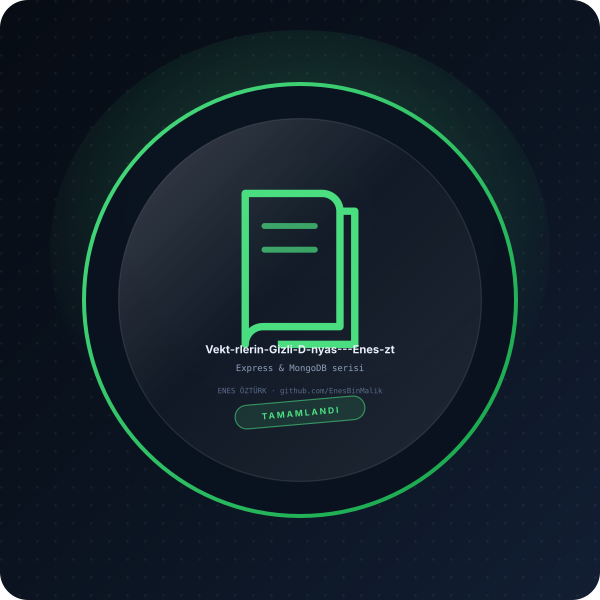

# Vekt-rlerin-Gizli-D-nyas---Enes-zt-rk-Blog



> **Express & MongoDB** — tasarım ve geliştirme: **Enes Öztürk**

---

Vekt-rlerin-Gizli-D-nyas---Enes-zt-rk-Blog — Enes Öztürk tarafından geliştirilmiş proje..

## Öne çıkanlar

- Sunucu, rota ve ara katman yapısı
- Model ve veri katmanı
- Görünüm şablonları ve form akışı
- Hata yönetimi

## Kurulum ve çalıştırma

```bash
npm install
npm run dev        # http://localhost:3000
```

| Komut | Not |
| --- | --- |
| `npm install` | bağımlılıklar |
| `npm run dev` | geliştirme sunucusu |
| `npm run build` | üretim derlemesi |

## Proje yapısı

```
├── index.html
├── package.json
├── docs/rozet.svg        # imza rozeti
└── src/                  # uygulama kaynakları
```

## Lisans

Bu proje **Enes Öztürk** tarafından geliştirilmiştir; tüm hakları saklıdır.
